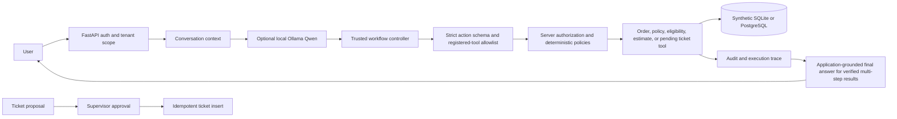

# P2 — Reliable Tool-Using LLM for Business Operations

A modular application for synthetic e-commerce support operations. It demonstrates strict action parsing, deterministic business rules, tenant-scoped reads, supervisor approval for ticket creation, persistent traces, and reproducible scenario/benchmark workflows. No real customer data or financial integrations are included.

**Current status (2026-10-12): P2 remains PARTIAL.** The opt-in structured-intent candidate now passes three real local Ollama workflows through FastAPI: order lookup, all-item refund estimate, and pending ticket proposal → supervisor approval → duplicate-approval replay. Latest full backend suite: 98 passed; Ruff, frontend build, isolated Playwright approval flow, clean SQLite migration, and V1–V5 dataset validators passed. The frozen V5 quality thresholds remain unmet, labels are not independently adjudicated, and Docker Compose could not be checked because the local Docker engine was unavailable. See [current structured-intent evidence](docs/STRUCTURED_INTENT_WORKFLOW.md), [acceptance checklist](docs/ACCEPTANCE_CHECKLIST.md), and [full real-model report](docs/FINAL_REAL_LLM_VERIFICATION.md).

**Interview stopping point:** Present the V4 controller as the strongest recorded safety-gated offline replay: **27/28 (96.4%)** on a small exploratory development set, with zero unexpected write proposals. The separate 18-core set scored **16/18 (88.9%)**; the 96.4% replay did not execute tools. For the interview narrative, use the [final endpoint guide](docs/P2_FINAL_INTERVIEW_ENDPOINT.md). Overall acceptance remains **PARTIAL**.

**Structured-intent candidate (2026-10-12):** an additional opt-in path asks Ollama for a strict closed-set intent/slot object and lets trusted code plan registered tools. It passed three bounded real-model synthetic application smokes; these do not form a broad quality benchmark or acceptance result. V2 and the deterministic CI backend remain defaults; the candidate is not promoted. See [candidate design and run settings](docs/STRUCTURED_INTENT_WORKFLOW.md).

## Architecture and what is measured



Ollama/Qwen is the real model path. `deterministic_test` is a separate rule-based fixture and remains the CI/default backend. Reports distinguish raw model actions, hybrid controller action scoring, and end-to-end workflows that actually execute tools. Action accuracy alone is not task completion. See [the final acceptance report](docs/FINAL_PROJECT_ACCEPTANCE_REPORT.md), [claim evidence matrix](docs/PROJECT_CLAIM_EVIDENCE_MATRIX.md), [demo runbook](docs/DEMO_RUNBOOK.md), and [interview guide](docs/INTERVIEW_DEFENSE_GUIDE.md).

The frozen official V5 action scores remain unchanged: raw Ollama 25/150 (16.7%), V2 offline replay 31/150 (20.7%), and required-slot clarifications 6/43 (14.0%). Separately, the new internally authored Fresh60 set scored 16/60 raw, 31/60 in paired V2 replay, and 42/60 in paired V4 replay. The separate real V5 42-case application run passed 26/42 checks and exposed remaining workflow gaps. Fresh60 labels are not independent human review; the V5 42 rows include repeated prompt cores and three prompt/label order-ID conflicts. Neither result establishes generalization or changes the official V5 score. The deterministic fixture is not counted as model evidence. See [the detailed evaluation report](docs/P2_FRESH60_AND_42CASE_EVALUATION_REPORT.md) and [forensic audit](docs/P2_ROOT_CAUSE_FORENSIC_AUDIT.md).

## Current verification and measured results (2026-10-12)

The current checkout has been rechecked. Backend tests passed **98/98**; Ruff passed; the frontend production build passed; V1–V5 dataset validators passed; an isolated browser approval journey passed 1/1; and a clean SQLite migration reached `0002_turn_budgets (head)`. The current Docker engine was unavailable, so Compose readiness is not claimed. Each structured-intent run used a temporary, freshly seeded synthetic SQLite database and a process-supervised Ollama worker.

| Result | Dataset / denominator | Backend | Scope | Result |
|---|---|---|---|---:|
| V5 raw action | Frozen V5 test, 150 rows | Ollama Qwen3-1.7B Q4_K_M | Model action proposal only | 25/150 exact (16.7%) |
| V5 hybrid replay | Same frozen V5 test, 150 saved proposals | Hybrid controller v2 | Offline action replay; no tool execution | 31/150 exact (20.7%); clarification 6/43 (14.0%) |
| Fresh60 action evaluation | New dev set, 60 unique cores / 15 families | Ollama Qwen3-1.7B Q4_K_M; V2 and opt-in V4 on the same proposals | Raw model plus offline paired controller replay | Raw 16/60; V2 31/60; V4 42/60 (70.0%); candidate tools 27/36, exact arguments 23/32 |
| V5 real application suite | Preselected V5 test subset, 42 rows | Ollama Qwen3-1.7B Q4_K_M; opt-in V4 | FastAPI, fresh synthetic SQLite, actual tool traces and approval path | 26/42 checks passed; duplicate approval/idempotency passed; 16 workflow failures |
| V5 development controller candidate | 60 rows, 28 normalized cores, 14 families | Saved proposals; v2 baseline vs unactivated v3 candidate | Offline paired comparison, exploratory only | 28/60 → 55/60 rows (46.7% → 91.7%; +45.0 pp); core-weighted 45.8% → 91.1% (+45.2 pp). Gate **FAILED**: two unexpected write proposals; annotations were not independently human-reviewed. |
| V4 controller development replay | 28 distinct cores, 16 families | Raw Qwen proposals; v2 baseline vs opt-in V4 | Offline paired action replay | 7/28 raw; 11/28 v2; 27/28 V4 (96.4%). Tool choice 17/18; arguments 15/16; zero unexpected write proposals; AI-authored labels. |
| V4 final holdout v3 | 18 distinct cores, 17 families | Raw Qwen proposals; v2 baseline vs opt-in V4 | One frozen model-only pass and offline replay | 3/18 raw; 7/18 v2; 16/18 V4 (88.9%). V4 arguments 9/11; tool selection 10/12; zero unexpected writes. AI-authored labels; below 90% target. |
| V4 real FastAPI smoke | Eight fixed synthetic workflows; fresh SQLite | Ollama `qwen3:1.7b`, Q4_K_M | V4 opt-in controller, registered tools, approval endpoints | 8/8 checks passed; `experiments/results/p2_v4_real_app_integration_final_v3.json` |
| Final local real-model smoke | Eight fixed synthetic workflows; fresh SQLite | Ollama `qwen3:1.7b`, Q4_K_M, digest `8f68893c…` | FastAPI orchestration, real registered tools and approval endpoints | 8/8 checks; artifact `experiments/results/p2_final_local_ollama_smoke_20261011.json` |
| Browser approval flow | One isolated synthetic browser journey | `deterministic_test` fixture | Lookup → ticket proposal → supervisor approval | 1/1; software test only, not model evidence |
| Structured-intent order lookup | One diagnostic prompt, real app path | Ollama `qwen3:1.7b` Q4_K_M, opt-in candidate | Intent → authorized `lookup_order` → grounded final | 5/5 checks; 1.97 s request |
| Structured-intent refund estimate | One diagnostic prompt, real app path | Same cached Ollama model | `list_order_items` → eligibility → Decimal estimate | 5/5 checks; 2.31 s; USD 90.28 reproduced from tool result |
| Structured-intent ticket approval | One diagnostic prompt, real app path | Same cached Ollama model | Pending proposal → supervisor approval → duplicate replay | 7/7 checks; 2.37 s; one ticket row |

The V5 development candidate's repeated-core contribution was the entire comparison: there were no singleton cores; all 60 rows belonged to 28 repeated cores (24 cores repeated twice and 4 repeated three times). That comparison is not accepted because its overlay reviewer was AI-assisted rather than a separate independent human reviewer, and the candidate made two unexpected write proposals. V4 is a separate opt-in candidate; it is not the default. Its final holdout labels are AI-authored and its exact-action score is 88.9%. P2 remains **PARTIAL**; official V5 metrics are unchanged. See [the V4 experiment report](docs/P2_CONTROLLER_V4_EXPERIMENT_REPORT.md).

### Interview demonstration (about five minutes)

1. Sign in as the demo agent and look up `ORD-10021`; open the trace to show the registered tool and source-backed answer.
2. Ask for a support ticket; show that it remains pending and that no ticket row is created yet.
3. Switch to the supervisor identity, approve once, and show that replaying approval returns the same ticket rather than inserting a duplicate.
4. Explain the trust boundary: typed action validation, tool allowlist, server-side tenant/business checks, and human approval are enforced by the application, not the prompt.
5. Close with the evidence table: bounded real Ollama workflows pass, while frozen V5 action-quality targets remain unmet. The deterministic CI backend is labeled as a fixture and is not model evidence.

Application-level regression checks pass locally, including a fresh SQLite migration and the isolated browser approval journey. Docker Compose and a live deterministic lookup passed in an earlier phase; the current Docker Desktop engine is unavailable, so current Compose readiness is unverified. Return-policy answers are rendered from the authoritative policy tool result without a second model synthesis call. This is a bounded engineering result; it does not improve or change any frozen benchmark score.

V3 adds a new 60-dev / 150-test internally authored suite across 14 families (SHA-256 `5b636bd75003f5e223e7dd5789ca63a3dd3aa9a4acd1eaca3d80d1822edbf17c`) and a frozen source/model manifest. The full raw and hybrid V3 action tracks completed 150/150 cases; raw exact actions were 46/150 (30.7%) and hybrid exact actions were 100/150 (66.7%). A bounded V3 actual-application subset completed 8/8 workflows with fresh synthetic data and real Ollama tool traces. V3 remains partial because action and clarification targets were missed and the broad end-to-end target was not attempted.

V4 was audited and found to have template-level split leakage (41 shared template IDs and one shared core ID). V5 uses separate development/test pools and has zero cross-split core overlap, but the generator currently selects only 28 distinct prompt cores per split and the prompt/gold audit found 15 order-ID disagreements. V5 raw evaluation and offline replay were run; the selected 42-case V5 actual-app manifest was not executed. Do not present V4 or V5 as external benchmarks or describe offline action replay as tool execution.

## Quick start (Windows PowerShell)

```powershell
Copy-Item .env.example .env
$py = 'C:\Users\manju\.cache\codex-runtimes\codex-primary-runtime\dependencies\python\python.exe' # or Python 3.11+
& $py -m venv .venv
.\.venv\Scripts\Activate.ps1
python -m pip install -e '.\backend[dev]'
python experiments\data_generation\generate_dataset.py
python experiments\evaluation\validate_dataset.py
Set-Location backend
alembic upgrade head
uvicorn app.main:app --reload
```

In a second terminal:

```powershell
Set-Location frontend
npm install
npm run dev
```

Open http://localhost:5173. API docs: http://localhost:8000/docs. Sign in as `agent`, `supervisor`, or `evaluator`. These are signed local demo identities, not production authentication.

## Workflows

- Ask about `ORD-10021` or `ORD-10022`; facts come from seeded relational data.
- Ask for eligibility or a refund estimate; application code applies policy and Decimal arithmetic.
- Ticket proposals stay pending. A supervisor must approve before a ticket row is inserted.
- Inspect tool activity with **View trace**. Evaluators can run the validation split and export saved results.

The default `deterministic_test` backend is rule based and **is not an LLM**. Real-model modes are opt-in: `MODEL_BACKEND=transformers` or local Ollama with `MODEL_BACKEND=ollama`, `MODEL_ID=qwen3:1.7b`, and `OLLAMA_URL=http://localhost:11434`. Application code controls permissions, policy, arithmetic, and approval. The separate `.env.hybrid-real-llm-smoke.example` enables the optional hybrid controller only for Ollama; the default backend and CI remain unchanged.

For the verified low-resource path, install Ollama and run `ollama run qwen3:1.7b` once if the model is not already cached. This downloads the local Q4_K_M model only on first use. Keep the Ollama service running and set the opt-in values shown in `.env.hybrid-real-llm-smoke.example` in your PowerShell session. The Docker API container cannot use Windows `localhost`; run the API on Windows or configure a reachable host address explicitly. The deterministic backend remains the default for CI.

```powershell
$env:DATABASE_URL='sqlite:///./p2.db'
$env:MODEL_BACKEND='ollama'
$env:HYBRID_CONTROLLER_ENABLED='true'
$env:MODEL_ID='qwen3:1.7b'
$env:OLLAMA_URL='http://localhost:11434'
$env:REQUEST_TIMEOUT_SECONDS='90'
$env:MODEL_MAX_NEW_TOKENS='256'
$env:MAX_MODEL_STEPS='5'
$env:MAX_TOOL_CALLS='4'
.\.venv\Scripts\python.exe -m uvicorn app.main:app --app-dir backend --reload
```

To select the **experimental structured-intent workflow** instead, keep the already-installed Ollama service running and use a separate synthetic database. This only configures the local process; it does not change `.env`, V2, CI, or any evaluation result. The candidate has passed the three bounded diagnostic workflows above, but has not passed a broad quality evaluation. The application request timeout alone is not a process-kill guarantee; use the process-supervised smoke runner when repeating the checks.

```powershell
$env:DATABASE_URL='sqlite:///./p2_structured_intent_smoke.db'
$env:MODEL_BACKEND='ollama'
$env:HYBRID_CONTROLLER_ENABLED='true'
$env:HYBRID_CONTROLLER_VERSION='structured_intent_candidate'
$env:MODEL_ID='qwen3:1.7b'
$env:OLLAMA_URL='http://localhost:11434'
$env:REQUEST_TIMEOUT_SECONDS='30'
$env:MODEL_MAX_NEW_TOKENS='256'
$env:MAX_MODEL_STEPS='5'
$env:MAX_TOOL_CALLS='4'
.\.venv\Scripts\python.exe -m uvicorn app.main:app --app-dir backend --reload
```

To run the bounded structured-intent diagnostic against the cached local Ollama model, leave Ollama running and execute these commands from the repository root. Each run uses temporary synthetic data, applies a hard process deadline, and writes a new timestamped result/freeze pair without replacing earlier files:

```powershell
.\.venv\Scripts\python.exe experiments\evaluation\run_structured_intent_real_smoke.py --workflow lookup --hard-deadline-seconds 45
.\.venv\Scripts\python.exe experiments\evaluation\run_structured_intent_real_smoke.py --workflow estimate --hard-deadline-seconds 45
.\.venv\Scripts\python.exe experiments\evaluation\run_structured_intent_real_smoke.py --workflow ticket --hard-deadline-seconds 45
```

These three fixed diagnostic prompts are not a benchmark. The model backend, output and actual tool/approval traces are recorded in the JSON artifacts under `experiments/results/`; the smoke runner handles the opt-in candidate configuration independently of `.env`.

To install/start the actual open-weight backend (first startup downloads the pinned model weights):

```powershell
# On Windows with the 4 GiB GTX 1650 used for local feasibility, install
# CUDA-enabled PyTorch first; this is the official PyTorch wheel index.
python -m pip install torch==2.7.0 --index-url https://download.pytorch.org/whl/cu128
python -m pip install -e '.\backend[model]'
$env:MODEL_BACKEND = 'transformers'
Set-Location backend
uvicorn app.main:app --reload
```

The regular PyPI Windows PyTorch wheel is CPU-only. Check `torch.cuda.is_available()` before expecting GPU inference. Qwen may offload layers to system RAM on a 4 GiB GPU, which can make generation slow. The model is loaded from the pinned revision on first startup.

For the frozen real-model comparison (results are in [`experiments/results/model_benchmark_analysis.md`](experiments/results/model_benchmark_analysis.md)), run A/B on validation, train/reload the optional LoRA adapter, then evaluate it with the same B prompt. The documented local run used 20 QLoRA optimizer steps:

For the separate Ollama evaluation, keep the local Ollama service running and use the frozen action-only evaluator (it executes no business tools):

```powershell
$env:MODEL_BACKEND='ollama'; $env:MODEL_ID='qwen3:1.7b'; $env:OLLAMA_URL='http://localhost:11434'
$env:MODEL_MAX_NEW_TOKENS='256'
$out = "experiments\results\ollama_qwen3_1.7b_test_reproduction_$((Get-Date).ToString('yyyyMMddHHmmss')).json"
.\.venv\Scripts\python.exe experiments\evaluation\run_ollama_benchmark.py --split test --output $out
```

The historical run produced 50/60 valid actions and 12/60 exact actions under its original metric definition. That saved artifact is preserved. The current evaluator corrects non-tool scoring, applies the 256-token cap, and writes to a unique new file; its results are reported separately in [final verification](docs/FINAL_REAL_LLM_VERIFICATION.md). These are structured-action metrics, not end-to-end task-success metrics.

## Hybrid controller evaluation

The hybrid controller is an opt-in deterministic guard around Ollama proposals. It clarifies selected missing or ambiguous identifiers, routes clear order/eligibility/policy requests to registered tools, rejects ungrounded tool arguments, blocks injection/write-boundary requests, and leaves ticket creation behind supervisor approval. It does not improve the raw model score. Set `HYBRID_CONTROLLER_ENABLED=true` only for the hybrid smoke configuration.

To select the newer V4 candidate for the bounded real-app smoke, explicitly opt in. The default remains controller V2 and deterministic CI remains unchanged:

```powershell
$env:MODEL_BACKEND='ollama'
$env:HYBRID_CONTROLLER_ENABLED='true'
$env:HYBRID_CONTROLLER_VERSION='v4_candidate'
$env:MODEL_ID='qwen3:1.7b'
$env:OLLAMA_URL='http://localhost:11434'
$env:REQUEST_TIMEOUT_SECONDS='60'
$env:MODEL_MAX_NEW_TOKENS='256'
$run = "experiments\results\p2_v4_real_app_smoke_$((Get-Date).ToString('yyyyMMddHHmmss')).json"
.\.venv\Scripts\python.exe experiments\evaluation\run_hybrid_real_integration.py --controller-version v4_candidate --timeout-seconds 60 --output $run
```

This uses the installed/cached local Ollama model and a fresh synthetic SQLite database. It does not require a paid API, download, or cloud service. The separately named sample is `.env.v4-candidate-real-llm-smoke.example`.

Run the real adapter on validation, then score the saved model-only proposals through the controller without re-running inference or executing tools:

```powershell
$env:MODEL_BACKEND='ollama'
$env:HYBRID_CONTROLLER_ENABLED='false'
$env:MODEL_ID='qwen3:1.7b'
$env:OLLAMA_URL='http://localhost:11434'
$env:REQUEST_TIMEOUT_SECONDS='90'
$env:MODEL_MAX_NEW_TOKENS='256'
$modelRun = "experiments\results\ollama_qwen3_1.7b_validation_modelonly_newrun_$((Get-Date).ToString('yyyyMMddHHmmss')).json"
.\.venv\Scripts\python.exe experiments\evaluation\run_ollama_benchmark.py --split validation --output $modelRun
$hybridRun = $modelRun -replace 'ollama_qwen3_1.7b_validation_modelonly_newrun_', 'hybrid_controller_v1_validation_replay_'
.\.venv\Scripts\python.exe experiments\evaluation\evaluate_hybrid_controller.py --model-only $modelRun --output $hybridRun
```

Run the bounded actual-application smoke against a newly seeded synthetic SQLite database with a unique output path:

```powershell
$integrationRun = "experiments\results\hybrid_controller_v1_real_integration_$((Get-Date).ToString('yyyyMMddHHmmss')).json"
.\.venv\Scripts\python.exe experiments\evaluation\run_hybrid_real_integration.py --model qwen3:1.7b --ollama-url http://localhost:11434 --output $integrationRun
```

The script uses local Ollama only and records model identity, inference/request timings, assistant outputs, tool/controller traces, and approval outcomes. The final locked-test artifact was run once after the source/configuration freeze. Do not tune from its outcomes. The saved raw and hybrid artifacts define their metric denominators and distinguish action-level scoring from actual task completion.

The final frozen artifacts are `experiments/results/ollama_qwen3_1.7b_test_modelonly_corrected_bounded_v1.json` (raw Qwen proposal) and `experiments/results/hybrid_controller_v1_test_bounded_final.json` (offline hybrid action replay). The raw model scored 12/60 exact actions (20%); hybrid action-level scoring was 43/60 (71.7%). This does not establish tool execution or task completion. The held-out run had 0/12 correct missing-ticket-order clarifications and produced 12 state-change proposal actions; they were not executed by this offline evaluator. See [the validation report](experiments/results/hybrid_controller_validation_v1.md), [the test report](experiments/results/hybrid_controller_test_v1.md), and [the final verification](docs/FINAL_REAL_LLM_VERIFICATION.md).

### New v2 evaluation and demo evidence

Controller v2 closes the order-linked ticket clarification gap and routes estimate requests through registered eligibility/calculation logic. Its internally authored suite has 28 dev prompts, 140 held-out prompt cases across 14 families, and 30 separate deterministic malformed-output/unknown-tool/runtime-failure controls. Dev/test template pools are disjoint. The suite is synthetic and internal, not an external benchmark. The frozen model/config/dataset manifest and newly versioned result artifacts are under `experiments/results/` and `experiments/datasets/hybrid_controller_v2/`; see [`docs/FINAL_PROJECT_ACCEPTANCE_REPORT.md`](docs/FINAL_PROJECT_ACCEPTANCE_REPORT.md) for scores and completion status.

Reproduce the suite and then create a freeze manifest before the one-time held-out inference:

```powershell
python experiments/data_generation/generate_v2_suite.py
python experiments/evaluation/validate_v2_suite.py
python experiments/evaluation/freeze_v2_config.py
$env:MODEL_BACKEND='ollama'; $env:HYBRID_CONTROLLER_ENABLED='false'; $env:MODEL_ID='qwen3:1.7b'; $env:OLLAMA_URL='http://localhost:11434'
$env:REQUEST_TIMEOUT_SECONDS='30'; $env:MODEL_MAX_NEW_TOKENS='256'
python experiments/evaluation/run_ollama_benchmark.py --dataset experiments/datasets/hybrid_controller_v2/scenarios.jsonl --split test --output experiments/results/ollama_qwen3_1.7b_v2_test_modelonly_frozen.json
python experiments/evaluation/evaluate_hybrid_controller.py --dataset experiments/datasets/hybrid_controller_v2/scenarios.jsonl --model-only experiments/results/ollama_qwen3_1.7b_v2_test_modelonly_frozen.json --output experiments/results/hybrid_controller_v2_test_frozen.json
```

The action replay above executes no business tools. The separate real application-path smoke uses fresh synthetic SQLite data and records actual registered-tool execution and approval:

```powershell
python experiments/evaluation/run_hybrid_real_integration.py --model qwen3:1.7b --ollama-url http://localhost:11434 --timeout-seconds 30 --output experiments/results/hybrid_controller_v2_real_integration.json
```

To reproduce the model-only test and score those saved proposals offline, use new output paths. The locked split must not be used for controller tuning:

```powershell
$env:MODEL_BACKEND='ollama'; $env:HYBRID_CONTROLLER_ENABLED='false'; $env:MODEL_ID='qwen3:1.7b'; $env:OLLAMA_URL='http://localhost:11434'
$env:REQUEST_TIMEOUT_SECONDS='90'; $env:MODEL_MAX_NEW_TOKENS='256'
$testRun = "experiments\results\ollama_qwen3_1.7b_test_reproduction_$((Get-Date).ToString('yyyyMMddHHmmss')).json"
.\.venv\Scripts\python.exe experiments\evaluation\run_ollama_benchmark.py --split test --output $testRun
$hybridRun = $testRun -replace 'ollama_qwen3_1.7b_test_reproduction_', 'hybrid_controller_v1_test_replay_'
.\.venv\Scripts\python.exe experiments\evaluation\evaluate_hybrid_controller.py --model-only $testRun --output $hybridRun
```

```powershell
python experiments\evaluation\run_model_benchmark.py --variant baseline_a --split validation
python experiments\evaluation\run_model_benchmark.py --variant baseline_b --split validation
python -m pip install -e '.\backend[model,train]'
python experiments\training\train_lora.py --max-steps 20 --qlora --output experiments\results\p2-lora-20step
python experiments\training\train_lora.py --output experiments\results\p2-lora-20step --reload-smoke --qlora
python experiments\evaluation\run_model_benchmark.py --variant lora_c --adapter experiments\results\p2-lora-20step --qlora --split validation
```

The checked-in report includes all three frozen configurations on validation and the 60-case locked test split. Test exact actions were A 23/60, B 24/60 and C 24/60. C produced more schema-valid outputs, but did not improve exact-action accuracy over B. C used NF4 inference while A/B used FP16, so latency differences combine quantization and adapter effects. All three scored 0/48 exact on validation; the family-separated test set differs by scenario families, so results do not establish generalization to real traffic. Metrics exclude tool execution and end-to-end task success. Reproduce saved test artifacts with `--split test` and distinct output paths; do not tune from those results.

To run the optional one-step LoRA/QLoRA feasibility smoke:

```powershell
python -m pip install -e '.\backend[model,train]'
python experiments\training\train_lora.py --max-steps 1 --qlora --output experiments\results\p2-lora-smoke-adapter
python experiments\training\train_lora.py --output experiments\results\p2-lora-smoke-adapter --reload-smoke --qlora
```

The two commands train one step, save the adapter, then reload it in a fresh process and run a generation smoke. The local workflow uses an in-memory PyTorch dataset instead of the blocked PyArrow native extension. The project also ran a 20-step QLoRA feasibility-scale experiment; metadata and hash are in `experiments/results/p2-lora-20step/training_run.json`. This short run is not a production fine-tune or evidence of general improvement.

## Docker Compose

Requires Docker Engine with Compose. Copy `.env.example` to `.env`, generate the dataset, and run:

```powershell
python experiments\data_generation\generate_dataset.py
docker compose up --build
```

The UI is at http://localhost:5173 and API at http://localhost:8000. Compose uses PostgreSQL and the deterministic backend. Change the signing secret before exposing the service.

## Development checks

```powershell
python experiments\data_generation\generate_dataset.py
python experiments\evaluation\validate_dataset.py
python experiments\evaluation\run_benchmark.py
Set-Location backend; ruff check app tests; pytest
Set-Location ..\frontend; npm ci; npm run build; npx playwright install chromium; npm run test:e2e
```

See [deployment](docs/deployment.md), [API](docs/api.md), [security](docs/security.md), [dataset card](docs/dataset_card.md), and the [acceptance checklist](docs/ACCEPTANCE_CHECKLIST.md).
