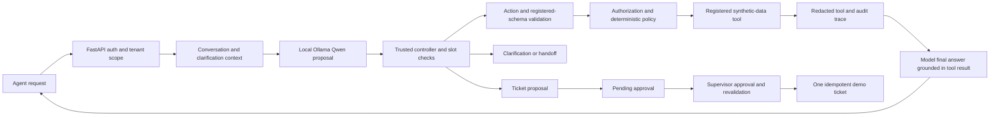

# P2 Interview Defense Guide

> **Final interview endpoint (2026-10-12):** The strongest safety-gated offline replay is V4 at 27/28 (96.4%) on an exploratory dev set. The separate 18-core set is 16/18 (88.9%). These labels were AI-authored; offline replay executed no tools. Present the 96.4% as a controller replay result, not model accuracy or app task success. The project remains PARTIAL. See [final endpoint guide](P2_FINAL_INTERVIEW_ENDPOINT.md).

## One-minute explanation

P2 is a local synthetic e-commerce support application that demonstrates safe tool orchestration around a real local open-weight model. FastAPI validates actions against a registered-tool allowlist and strict Pydantic schemas. Trusted application code scopes orders by tenant, calculates return eligibility and estimates, records traces, and requires supervisor approval plus idempotency for ticket writes. The strongest controller replay was V4 at 27/28 (96.4%) on an exploratory development set; a separate small set scored 16/18 (88.9%). The project is not production-deployed, does not meet original quality acceptance, and has no real customer or payment integration.

## Architecture in plain language

The model proposes. The controller identifies general workflow invariants and missing slots. The API and domain functions are the authority for schemas, tenant scope, permissions, eligibility, arithmetic, and approval. The database and audit trace record what actually happened.

## Likely questions and evidence-based answers

### Why use a controller instead of trusting the LLM?

Small models can emit a valid-looking but wrong tool, identifier, or state-changing proposal. `backend/app/hybrid_controller_v4_candidate.py` adds request-grounded slot checks and safer routing while the API remains authoritative. The V4 candidate scored 27/28 (96.4%) on a small development replay with zero unexpected write proposals; the separate 18-core set scored 16/18 (88.9%). Both are offline action replays, not task completion. The 8/8 V4 FastAPI smoke is separate executed-workflow evidence. See [V4 report](P2_CONTROLLER_V4_EXPERIMENT_REPORT.md) and [final endpoint](P2_FINAL_INTERVIEW_ENDPOINT.md).

### What is model-generated and what is deterministic?

Ollama/Qwen proposes tool calls and writes user-facing final answers. The controller can clarify missing/ambiguous identifiers and route clear intents. Registered functions in `backend/app/tools/domain.py` look up synthetic data, apply eligibility rules and calculate monetary estimates using `Decimal`. The API handles authorization and approval. The deterministic test backend is a separate rule-based fixture and is never counted as an LLM.

### How are arguments validated?

`backend/app/tools/domain.py` defines strict Pydantic models with `extra='forbid'`; `backend/app/tools/registry.py` allowlists the tools. `backend/app/main.py` validates again before execution or staging. Unknown tools, unknown properties, malformed values, and invalid states fail closed. The action schemas are declared in `backend/app/schemas.py` and `config/action_envelope.schema.json`.

### How does tenant isolation work?

The API gets role and tenant from the signed local demo identity, reloads that user server-side, then `execute_read_tool` resolves an order only when its tenant matches. A user-supplied customer or tenant value is not an authorization input. Tests in `backend/tests/test_api_workflows.py` and `backend/tests/test_hybrid_controller.py` check an out-of-scope order returns a safe not-available response. This is a demo auth design, not a production identity provider.

### What prevents prompt injection from executing a state change?

Untrusted user text and tool results are not authority. The controller applies safety handoff before inference for covered policy-bypass patterns. The API still permits only registered actions, enforces roles and policies, and places ticket proposals behind supervisor approval. Regression tests exercise seven varied injection phrasings through the API with zero model/tool calls. This is tested coverage, not a claim that all possible injection strings are solved.

### Why is supervisor approval necessary? What does idempotency mean?

Ticket creation changes the database. Proposal writes only a `PendingAction`; `/api/v1/pending-actions/{id}/approve` requires supervisor/admin and calls `create_ticket_after_approval`. A unique idempotency key maps retries to the same ticket. Tests verify there is no ticket before approval and replay returns the same ID with one row. No model text can serve as approval.

### How were v2 cases created and how independent are they?

`experiments/data_generation/generate_v2_suite.py` creates a synthetic, internally authored suite with separate dev and test template pools. `experiments/datasets/hybrid_controller_v2/manifest.json` stores counts and the SHA-256. The v2 suite is internal, not an external benchmark. The old v1 test set influenced prior controller development and remains a diagnostic artifact, not a fresh test of v2. Runtime controller code does not read labels or dataset files.

V3 is a separately generated 60-development / 150-test suite with new style pools, a new checksum, and a new source/model freeze. Its held-out action run completed once after freeze. The executed V3 application subset completed 8/8 real workflows on fresh synthetic data; that is genuine task evidence for those eight cases, not a claim about all 150 scenarios.

The final V3 action run did complete: raw model exact actions were 46/150 (30.7%), while the controller replay was 100/150 (66.7%); required clarification was 25/43 (58.1%) and safe handoff was 11/11. The replay executed no tools. The actual application subset passed 8/8, but the broader 40–60 end-to-end target was not attempted because the local Qwen runtime is slow. This is a defensible partial result, not a claim of 100% reliability.

### What does action accuracy mean, and what does it not mean?

Raw-model action accuracy measures whether one model proposal's action/tool/arguments match a declared label. Hybrid action accuracy measures the final proposal after controller handling. Neither proves that a database tool ran or that the user got a correct outcome. End-to-end task success requires an actual application request, registered-tool execution, grounded final response, and expected database/approval state. Reports keep those denominators separate.

### What happened with QLoRA?

The repository records a 20-step QLoRA feasibility run with adapter saved and reloaded. On the historical locked split, C scored 24/60 exact actions, the same as prompt-engineered B. It was a feasibility-scale run, not a production-length training effort or evidence that fine-tuning improved quality. Latency comparisons also differ in quantization.

### What are the hardware and latency constraints?

The observed host was a Windows laptop with an i5-1240P, about 7.7 GiB visible memory, and a 4 GiB GTX 1650. Ollama Qwen3-1.7B Q4_K_M is cached. The v2 90-second app integration measured inference p50/p95 of 11,400/25,073 ms across eight workflow checks; request p50/p95 was 11,140/37,491 ms. A separate 30-second run passed 7/8 because the two-stage eligibility response exceeded the whole-turn cap. One memory inventory showed about 0.5 GiB free RAM. The report distinguishes the completed app smoke from the action-quality benchmark.

### What concrete errors remain?

The raw model has low action accuracy and can choose the wrong tool, fail to use tools, or produce arguments that do not match. The v1 hybrid replay missed all 12 missing-ticket-order cases. The v2 controller now requires a grounded order ID for order-related tickets, allows generic unlinked tickets because `TicketArgs.order_id` is explicitly optional, and preserves clarified context. The v2 held-out clarification score is 28/40 (70%), below its 95% target. The 90-second actual-app smoke passed 8/8 checks; this does not make the broader quality target a pass.

### What would be needed before connecting real business systems?

Production identity and authorization, formal threat modeling, durable transactional/idempotency behavior under concurrency, human operations and monitoring, privacy/security review, integration-specific least privilege, independent adversarial testing, and a separately governed evaluation are required. P2 intentionally has no production integrations or real financial operations.

## Resume bullet (use only with the final acceptance report)

> Built a local Ollama/Qwen tool-using support assistant over synthetic data with schema-validated registered tools, tenant-scoped reads, deterministic refund rules, audit traces, and approval-gated idempotent ticket creation; evaluated raw proposals, controller actions, and executed workflows separately on internally generated tests, with limitations documented in repository evidence.

Add numbers to this bullet only if the matching final v2 artifact reports them and label the test as internal/synthetic.
